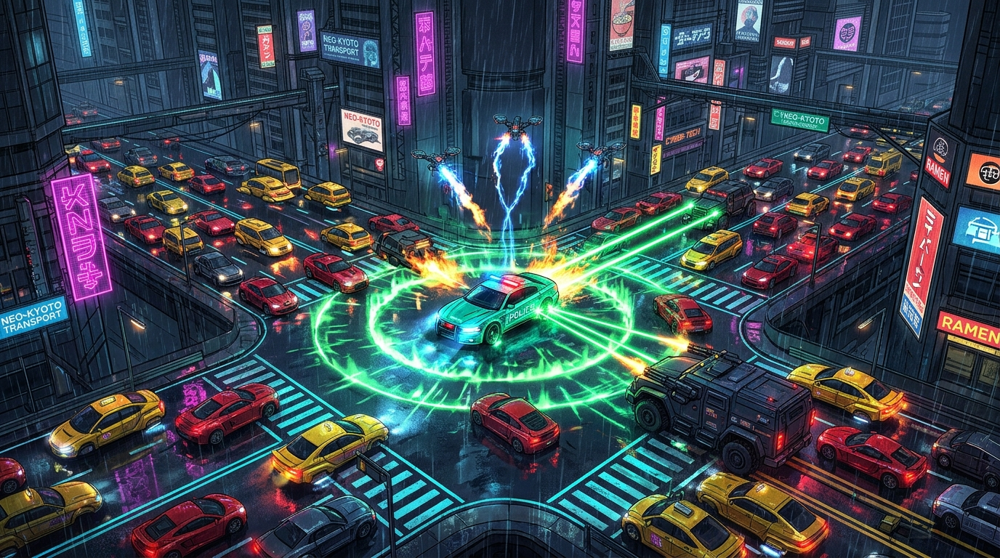
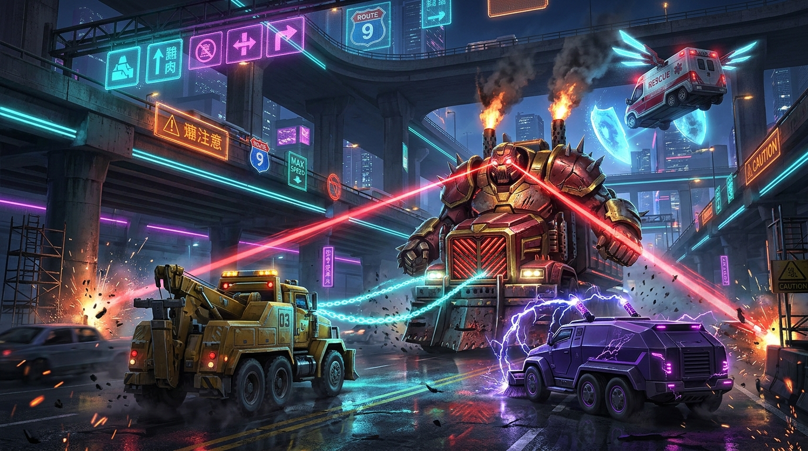

# 🚨 NEON FLOW : GRIDLOCK SURVIVORS

> **도시 교통 체증 뱀서류 액션 게임 & 신호 최적화 실험실**  
> **Live Demo (GitHub Pages):** https://tac0de.github.io/neon-flow/



`NEON FLOW : GRIDLOCK SURVIVORS`는 기존 도시 교통 시뮬레이터 **NEON FLOW**의 도로망·신호등·병목 역학을 기반으로 제작된 **교통 체증 테마 뱀서류(Vampire Survivors-like) 탄막 액션 생존 게임**입니다. 상단 모드 전환 버튼을 통해 **뱀서류 게임 모드**와 **도시 교통 실험실 샌드박스 모드**를 언제든 오갈 수 있습니다.

---

## 🎮 주요 게임 특징 (Gridlock Survivors v2.0)

### 1. 도심 정체 게이지, 교차로 해킹 & 그린웨이브 피버 (FEVER TIME)
- 사방에서 밀려드는 **칼치기 총알택시, 나홀로 출근 세단, 꼬리물기 SUV, 불법주정차 탑차, 폭주 슈퍼카, 위험물 유폭 탱크로리, 과적 트레일러** 군단을 단속하여 도심 마비를 막아내세요.
- **도심 마비도 35% 이하 유지 시**: `쾌적 소통 버프` 발동 (**경험치 획득 +20% · 이동속도 +12%**).
- **🔥 그린웨이브 피버 (Fever Overdrive)**: 연속으로 체증 차량을 처치해 피버 게이지가 100%에 도달하면 8초간 **모든 무기 쿨타임 35% 추가 감소 · 공격력 +25% · 이동속도 +22%**가 발동합니다.
- **⚡ 교차로 신호 마비 미션**: 주기적으로 마비된 교차로 원 안에 진입해 신호를 해킹하면 **그린웨이브 신호 연동 충격파**가 터지며 주변 차량을 일소하고 정체도를 **-28%** 감소시킵니다.

### 2. 출동 기체 클래스 6종 (고유 SVG 스프라이트 적용)
| 기체 명칭 | 기본 장착 무기 | 고유 특전 |
| :--- | :--- | :--- |
| **사이버 순찰 인터셉터** | 🟢 그린웨이브 신호탄 | 이동속도 +12% · 쿨타임 -7% |
| **헤비 마그넷 견인차** | ⛓️ 플라즈마 견인 체인 | 최대 내구도 높음 · 공격력 +15% · 범위 +12% |
| **AI 신호 관제 드론** | 🛰️ 회전교차로 위성 드론 | 쿨타임 -15% · 통행권 젬 자력 반경 +30% |
| **도심 정체 파쇄 장갑차** | 🔮 교차로 EMP 역장 | 공격 범위 +28% · 공격력 +10% |
| **네온 긴급 구급차** | ⚡ 신호등 연쇄 스파크 | 나노 자가수리 · 이속 +10% · 자력 +25% |
| **수도권 광역 전철포** | 🚄 초전도 차선 레일건 | 공격력 +22% · 공격 범위 +15% |

### 3. 교통 통제 무기 10종 & ★궁극 진화 (Weapon Evolution)
무기를 **Lv.5**까지 강화하고 대응하는 **시너지 보조 모듈**을 보유하면 레벨업 또는 보스 보물상자에서 **★궁극 진화 무기**로 각성합니다.

- 🟢 **그린웨이브 신호탄** + *신호 주기 가속 코일* ➔ **★ 초록불 무한 연동망**
- ⛓️ **플라즈마 견인 체인** + *고전압 단속 배터리* ➔ **★ 초전자 그라비티 렉카**
- 🛰️ **회전교차로 위성 드론** + *광역 교통 관제 안테나* ➔ **★ 메가 회전교차로 결계**
- 🔮 **교차로 EMP 역장** + *하이패스 자력 수집기* ➔ **★ 완전 무정체 도심 돔**
- ⚡ **과속 단속 궤도 레이저** + *신호 주기 가속 코일* ➔ **★ 인공위성 무인 단속포**
- 🚀 **우회 유도 마이크로 드론** + *다중 차선 분배 프로세서* ➔ **★ AI 전방위 우회 폭격기**
- 💿 **하이패스 톨게이트 블레이드** + *버스전용차로 터보 엔진* ➔ **★ 무정차 하이패스 폭풍**
- 🚦 **스마트 신호등 포탑** + *광역 교통 관제 안테나* ➔ **★ 중앙관제 AI 메가타워**
- ⚡ **신호등 연쇄 스파크** + *다중 차선 분배 프로세서* ➔ **★ 도심 초전도 뇌전 스톰**
- 🚄 **초전도 차선 레일건** + *고전압 단속 배터리* ➔ **★ 하이퍼루프 종단 파괴포**



### 4. 조작 방법 & 액티브 전술 스킬
- **이동**: `WASD` / `방향키` / 마우스 클릭 드래그 및 터치 가상 조이스틱
- **긴급 사이렌 돌파 (`Space`)**: 일시 무적 대시 + 주변 차량 충격파 넉백 및 정체도 `-10%` 감소
- **전 도시 그린웨이브 동기화 (`Q`)**: 전 교차로 신호 동기화 낙뢰 타격 + 반경 480m 경험치 젬 일괄 흡수 + 정체도 `-20%` 감소
- **🤖 AI 파일럿**: 상단 `[AI 파일럿]` 버튼을 켜면 AI가 스스로 위험 차량을 회피하고 경험치 젬과 교차로 해킹 미션을 수행합니다.

---

## 🛠️ 로컬 실행 및 빌드

```bash
npm install
npm run dev      # 개발 서버 실행
npm test         # Vitest 단위 테스트 실행
npm run build    # 프로덕션 빌드 (dist/)
```
